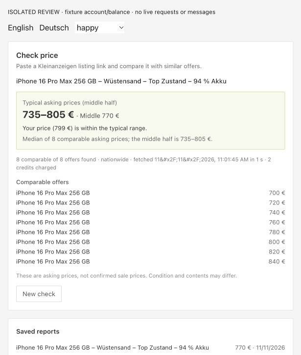
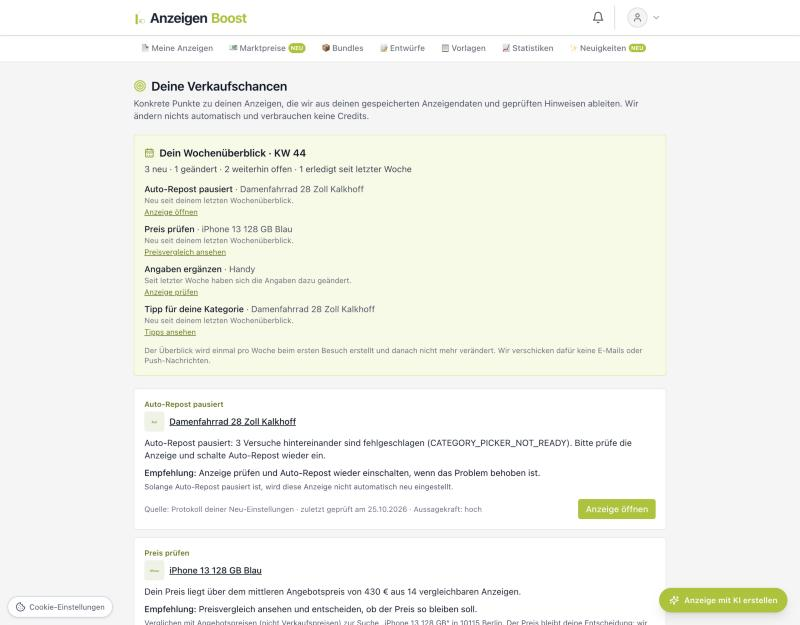

# Kleinanzeigen Seller Toolkit

### Verkaufen auf Kleinanzeigen: weniger raten, klarer antworten, Anzeigen besser vorbereiten.

**Kostenlose Werkzeuge von [AnzeigenBoost](https://anzeigenboost.de/)** · [Toolkit direkt öffnen](https://rebaiahmed.github.io/kleinanzeigen-seller-toolkit/) · [Chrome-Erweiterung ansehen](https://chromewebstore.google.com/detail/noagiapohlenpolcbeghlmngalapbobe)

> Unabhängiges Community-Projekt. Keine Verbindung zur Kleinanzeigen GmbH.

## Was AnzeigenBoost für Verkäufer interessant macht

**„Was verlangen andere für mein iPhone?“** Ähnliche Angebote vergleichen und den eigenen Preis einordnen.

*Beispielansicht mit Testdaten. Die gezeigten Preise sind keine aktuellen Marktpreise oder Verkaufsergebnisse.*

**„Was sollte ich an meiner Anzeige verbessern?“** Verkaufschancen, Preis und fehlende Angaben im Blick behalten.

*Beispielansicht der Oberfläche; keine Aussage über tatsächliche Verkaufsergebnisse.*

**„Schon wieder ,Geht noch was?‘“** KI-Antwortvorschläge helfen beim Formulieren. Du prüfst die Nachricht und entscheidest selbst, was du sendest.

**„Ich wollte die Anzeige doch neu einstellen …“** Reposts lassen sich in AnzeigenBoost planen.

*Die beiden Bildgeschichten sind Illustrationen, keine Kundenberichte oder Aufnahmen einer echten Konversation.*

**Du möchtest Konkurrenzpreise vergleichen, Anzeigen optimieren oder Reposts planen? [Entdecke AnzeigenBoost.](https://anzeigenboost.de/)**

## Drei kostenlose Kleinanzeigen Tipps zum Ausprobieren

Das [Toolkit im Browser](https://rebaiahmed.github.io/kleinanzeigen-seller-toolkit/) funktioniert ohne Konto:

1. **Kleinanzeigen Preisrechner:** Kaufpreis, Zustand und Alter eingeben und eine grobe Spanne sehen. Eine offene Heuristik, **kein Marktwert** und keine Live-Daten.
2. **Kleinanzeigen Antwortvorlagen:** Acht deutsche Antworten für Preisfragen, Versand, Abholung und mehr bearbeiten und kopieren.
3. **Kleinanzeigen Anzeige optimieren:** Sechs Punkte für Titel, Fotos, Zustand, Preis, Kategorie und Übergabe abhaken.

Für Entwickler: lokal starten, Heuristik und Datenschutz

Benötigt Node.js 22.6 oder neuer. Mit `npm ci` und `npm run dev` lokal öffnen. `npm test` prüft die Preisrechnung, `npm run build` erstellt die GitHub-Pages-Version. Der Workflow unter [`.github/workflows/deploy.yml`](.github/workflows/deploy.yml) veröffentlicht nach einem Push auf `main`.

Der Preisrechner nutzt `Kaufpreis × Zustandsfaktor × Altersfaktor`, dann ±15 % um den Mittelwert. Die Faktoren stehen in [src/price.ts](src/price.ts); ein Beispiel steht unter [examples/preisbeispiel.md](examples/preisbeispiel.md). Modell, Zubehör, Nachfrage, Region und echte Verkaufspreise fließen nicht ein.

Kein Backend, keine Konten, kein Tracking, kein Scraping und keine Kleinanzeigen-API. Nur der Checklisten-Fortschritt wird lokal im Browser gespeichert. Preisangaben und bearbeitete Antworten werden nicht übertragen. Details und Beiträge: [CONTRIBUTING.md](CONTRIBUTING.md) · [MIT-Lizenz](LICENSE).

## Häufige Fragen

**Ist der Preisrechner eine echte Marktanalyse?** Nein. Er zeigt nur eine illustrative Schätzung aus deinen Eingaben. Für Konkurrenzpreise nutze echte Vergleichsangebote.

**Kann das Toolkit Antworten automatisch verschicken?** Nein. Du bearbeitest und kopierst eine Vorlage; das Senden bleibt bei dir.

**Gehört das Toolkit zu Kleinanzeigen?** Nein. Es ist ein unabhängiges Projekt des AnzeigenBoost-Entwicklers.
