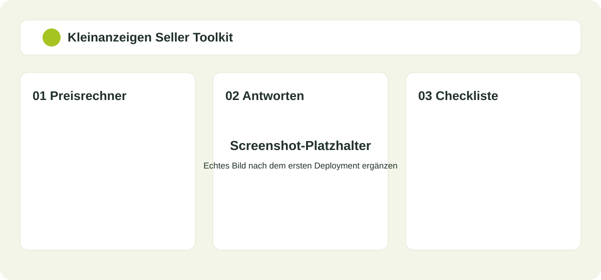

# Kleinanzeigen Boost Seller Toolkit

**Von AnzeigenBoost: kostenlose Kleinanzeigen Tipps und drei kleine Werkzeuge für private Verkäufer.** Schätze einen groben Preisbereich, formuliere eine Antwort und prüfe deine Anzeige vor dem Veröffentlichen. Ohne Konto, Backend, Tracking oder Datenabruf von Kleinanzeigen.

**[Live-Demo öffnen](https://rebaiahmed.github.io/kleinanzeigen-boost-seller-toolkit/)** · [Quellcode ansehen](https://github.com/Rebaiahmed/kleinanzeigen-boost-seller-toolkit)

> **Unabhängiges Community-Projekt:** Dieses Toolkit ist kein offizielles Angebot der Kleinanzeigen GmbH und steht in keiner Verbindung zu ihr.

## Ein Blick auf die Werkzeuge

| Werkzeug | Wofür es hilft | Grenze |
| --- | --- | --- |
| **Kleinanzeigen Preisrechner** | Einen transparenten, groben Preisbereich aus Kaufpreis, Zustand und Alter ableiten | Keine echten Markt- oder Verkaufspreise |
| **Kleinanzeigen Antwortvorlagen** | Acht höfliche deutsche Nachrichten bearbeiten und kopieren | Du prüfst Fakten und sendest selbst |
| **Anzeigen-Checkliste** | Titel, Fotos, Zustand, Preis, Kategorie und Übergabe prüfen | Kein automatischer Qualitäts- oder Ranking-Check |



*Bildplatzhalter: Nach der ersten GitHub-Pages-Veröffentlichung kann hier ein echter Screenshot der Oberfläche eingefügt werden. Eine kurze Anleitung steht in [docs/screenshots.md](docs/screenshots.md).*

## Kleinanzeigen Preisrechner: So funktioniert die Schätzung

Gib den ursprünglichen Kaufpreis, den Zustand und das Alter des Artikels ein. Optional kannst du deinen Wunschpreis mit der groben Spanne vergleichen. Die Rechnung ist offen einsehbar:

`Kaufpreis × Zustandsfaktor × Altersfaktor`, anschließend `±15 %` um den Mittelwert.

Die Faktoren stehen in [src/price.ts](src/price.ts) und können geändert werden. Das Ergebnis ist **eine illustrative Heuristik, keine Marktwertermittlung**. Das Toolkit ruft weder Kleinanzeigen noch eine andere Marktdatenquelle ab. Modell, Zubehör, Nachfrage, Region und tatsächlich erzielte Verkaufspreise bleiben unberücksichtigt. Vergleiche ähnliche Angebote selbst, bevor du deinen Preis festlegst.

Ein Rechenbeispiel findest du unter [examples/preisbeispiel.md](examples/preisbeispiel.md).

## Kleinanzeigen Antwortvorlagen: freundlich und konkret

Die Vorlagen decken „Was letzte Preis?“, niedrige Angebote, Festpreis, Gegenangebote, Versand, Abholung, Reservierungen und nicht erschienene Interessenten ab. Du kannst jeden Text im Browser ändern und anschließend mit einem Klick kopieren. Platzhalter wie `[TAG]` oder `[DEIN GEGENANGEBOT]` müssen vor dem Senden ersetzt werden. Der Versand-Entwurf behauptet bewusst nicht, dass du tatsächlich versendest.

## Kleinanzeigen Anzeige optimieren: sechs Punkte prüfen

Die interaktive Checkliste fragt nach einem verständlichen Titel, guten Fotos, ehrlichem Zustand, plausiblem Preis, passender Kategorie und klaren Angaben zur Übergabe. Dein Fortschritt liegt nur im lokalen Speicher deines Browsers. Der Reset-Knopf löscht ihn wieder.

## Lokal starten

Benötigt **Node.js 22.6 oder neuer** und npm.

```bash
npm ci
npm run dev
```

Öffne die angezeigte lokale Adresse. Für die automatischen Preisrechner-Tests und den Produktions-Build:

```bash
npm test
npm run build
```

## GitHub Pages

Der Workflow [`.github/workflows/deploy.yml`](.github/workflows/deploy.yml) führt Tests und Build aus und veröffentlicht `dist/` nach einem Push auf `main`. Im Repository unter **Settings → Pages → Build and deployment** als Quelle **GitHub Actions** wählen. Danach ist die Demo unter `https://rebaiahmed.github.io/kleinanzeigen-boost-seller-toolkit/` erreichbar. Bei einem Fork musst du den Demo- und Canonical-Link sowie `VITE_BASE_PATH` (automatisch aus dem Repo-Namen) prüfen.

## Datenschutz und Grenzen

- Kein Backend, Benutzerkonto, Analytics-Skript, externer Font oder Tracking-Cookie.
- Keine Scraping-Funktion und kein Aufruf einer Kleinanzeigen-API.
- Der Rechner verarbeitet Eingaben im Browser. Die Checkliste nutzt nur `localStorage`; Antworttexte werden nicht gespeichert.
- „Kopieren“ benutzt die Zwischenablage nur nach deinem Klick. Falls der Browser das verhindert, wird der Text markiert.
- Externe Links führen zu GitHub und AnzeigenBoost erst nach einem Klick.

## FAQ: Kleinanzeigen Tipps

**Ist der Preisbereich ein echter Marktpreis?** Nein. Er entsteht ausschließlich aus den sichtbaren Faktoren in `src/price.ts`. Für eine realistische Preisentscheidung vergleiche Zustand, Modell, Zubehör und Region mit ähnlichen Angeboten.

**Warum wird mein Artikel mit zunehmendem Alter günstiger geschätzt?** Das ist eine einfache Standardannahme. Manche Sammlerstücke und knappe Produkte verhalten sich anders; dafür ist dieser Rechner ungeeignet.

**Kann ich die Antwortvorlagen direkt an Käufer senden?** Nein. Das Toolkit kopiert nur den bearbeiteten Text. Du entscheidest selbst, ob und wie du ihn sendest.

**Werden meine Eingaben gespeichert?** Nur der Fortschritt der Checkliste bleibt lokal im Browser. Preise und bearbeitete Antworten werden nicht gespeichert oder übertragen.

**Ist dieses Projekt von Kleinanzeigen?** Nein. Es ist ein unabhängiges Community-Projekt.

## Über AnzeigenBoost

Der Ersteller dieses Toolkits entwickelt auch [AnzeigenBoost](https://anzeigenboost.de/), eine separate [Chrome-Erweiterung](https://chromewebstore.google.com/detail/noagiapohlenpolcbeghlmngalapbobe) für Verkäufer. Du möchtest Konkurrenzpreise vergleichen, Anzeigen optimieren oder Reposts planen? Entdecke AnzeigenBoost. Manche Funktionen dort benötigen ein Konto und Credits; dieses Toolkit bleibt eigenständig und kostenlos.

## Mitmachen

Fehler, verständlichere Vorlagen und Verbesserungsideen sind willkommen. Bitte lies [CONTRIBUTING.md](CONTRIBUTING.md). Der Code steht unter der [MIT-Lizenz](LICENSE).
